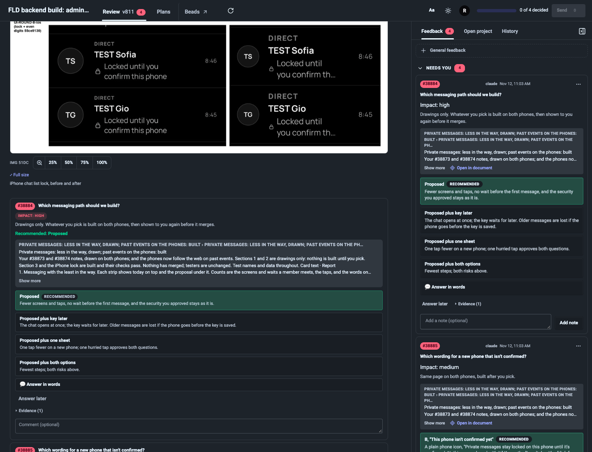
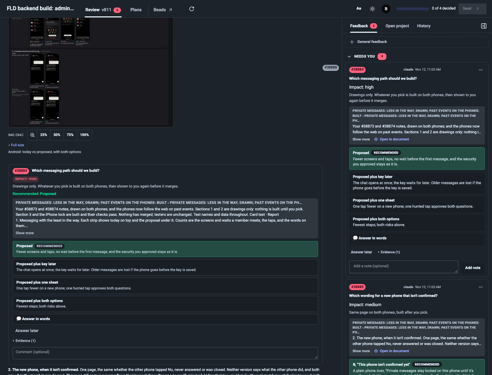
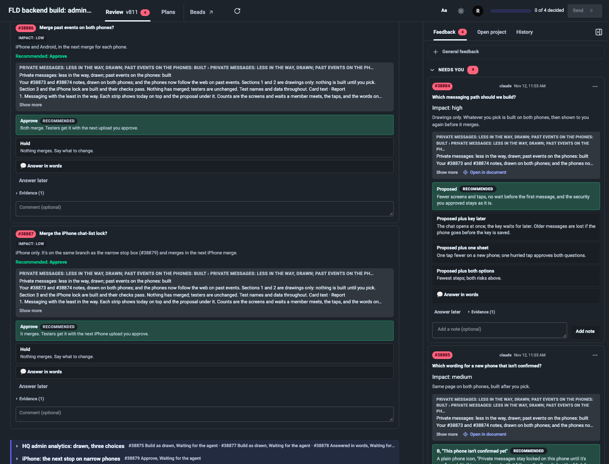
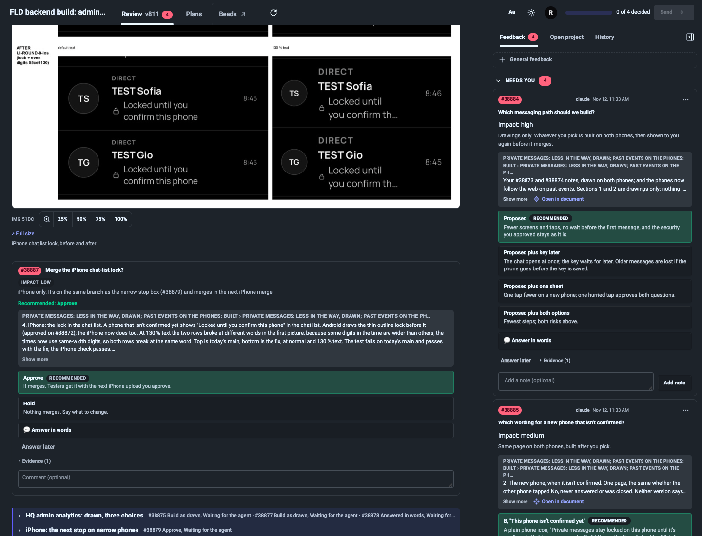

# Card context and placement investigation — 2026-11-13 UTC

The renderer is wrong for inline ask cards using their default section citation. First affected release: **2.29.0**, published 2026-11-07 20:30:58 UTC. The fix uses the card's existing authored position to scope its excerpt and keep it beside its own screenshots. Added agent characters, AI tokens and orchestrator steps: **0 per card**.

## Evidence from copies of the five named pages

`annotate doctor --versions` reported the live runtimes as 2.31.2 (`d0d2a71de864`). Registry records supplied the folders below. All SQLite queries ran against copied `page.db`/WAL files; JSON comments and sources were also copied before inspection. No inbox, claim, resolve, publish or bead command was run.

Dates below are UTC. Counts include archived rows, not just currently open cards.

| Page / copied item count | Version and report date | Card / location | Report |
|---|---|---|---|
| FLD usage audit/page / 107 | v18, 2026-11-09 19:53:11 | note 29, `s:windmill-and-orca-ranked-opportunities-for-note1` | “list these out as separate cards that present the context and relevant pros and cons” — a request for card authoring, not proof of excerpt misplacement |
| FLD usage audit/page / 107 | v39, 2026-11-10 06:13:15 | 53, `d:q53` | “your context is also cut off after d18's mtnioned of 6 hour swee...” — a related clipping report |
| reviews/fld-stack-round8 / 3,899 | v811, 2026-11-13 04:15:22 | 38884, `d:q38884` | “Where is the proposed … not seeing where it is in the images above” and “why is your context the entire summary … for private messages?” |
| reviews/fld-stack-round8 / 3,899 | v811, 2026-11-13 04:16:35 | 38887, `d:q38887` | “Your context provided is just the full history of private messages, not for this specific card.” |
| rebex/rebex / 371 | v195, 2026-11-12 18:33:01 | 238, `d:q238` | “including the full status update … or maybe the entire project for a singular card” and a request to explain why two more hours are needed |
| multimac-orch/multimac-orch / 26 | v10, 2026-10-30 17:04:59 | unnumbered comment, `s:m1max16-install:code1` (the install command associated with card 20) | “The command is cut off … easy copy button/icon” — a command/copy report, not the section-context bug; no matching wrong-context report found |
| fld-admin-meeting/fld-admin-meeting / 21 | v1–v4 | cards 1–6 | No reviewer context report found in either the copied database or JSON; these rows have no reviewer answers/replies |

The folders were:

- `/Users/changlee/projects/FastLane Drive/planning/operations/usage-audit-2026-11-06/page`
- `/Users/changlee/projects/fastlane-drive/reviews/fld-stack-round8`
- `/Users/changlee/projects/rebex/reviews/rebex`
- `/Users/changlee/projects/multimac-orch/reviews/multimac-orch`
- `/Users/changlee/projects/fastlane-drive/reviews/fld-admin-meeting`

## Reproduced in real headless Google Chrome

The sandbox copied FLD's v811 HTML, original source, comments, metadata and all image files referenced by the HTML, including previews and originals. Only the four reported section cards' copied reviewer states were reset to open, recreating the view before Chang answered them; the document and images were unchanged. It served on **18741**, with an absolute `PYTHONPATH` to this checkout's `src` for the fixed runtime and to an isolated 2.31.2 wheel for the baseline. All six relevant images loaded with nonzero natural dimensions. Every server and Chrome instance was closed in `finally` blocks.

The source puts the four asks immediately after their respective evidence:

1. Messaging path: two phone drawings, then 38884.
2. Unconfirmed phone: its drawing, then 38885.
3. Past events: two before/after pictures, then 38886.
4. Chat-list lock: its before/after picture, then 38887.

There is **no `see:` line on any of those four asks**. `Renderer.ask_block()` supplies the same enclosing section anchor to all four. The stored contexts remain distinct:

- 38884: “Drawings only. Whatever you pick is built on both phones, then shown to you again before it merges.”
- 38887: “iPhone only. It's on the same branch as the narrow stop box (#38879) and merges in the next iPhone merge.”

Before the fix, `stripTarget()` treats that section as the evidence endpoint and inserts every strip **outside and after the entire section**, below the lock screenshot. `excerptMap()` indexes quotes only by section anchor; each strip gets the same **5,190-character** quote. `excerptText()` also includes hidden static cards, duplicating other questions and options inside the quote. The body and rail both do this. The context sentence itself is not being overwritten.

After the fix, the same cards stay at their authored locations inside the section. Card 38884 quotes its preceding messaging block (**1,854 characters**); 38887 quotes only its lock block (**615 characters**). Static fallback cards are excluded from excerpts. Both retain their exact original context sentence. Body cards, rail cards and expanded evidence previews share the scoped quote. Adjacent asks without intervening prose share the same preceding evidence. Explicit citations elsewhere retain their existing placement.

| Card 38884 before: messaging question below the lock image | After: below its Android messaging drawing |
|---|---|
|  |  |

| Card 38887 before: repeats the section introduction | After: quotes the lock explanation beside its picture |
|---|---|
|  |  |

Machine-readable [baseline DOM text](card-context-20261113/before-render.json), [fixed DOM text](card-context-20261113/after-render.json) and [release results](card-context-20261113/release-results.json) accompany the screenshots.

## First bad release

Official wheels were downloaded from `changl/agent-annotate` GitHub Releases into temporary venvs. Each rendered the **same verbatim FLD section source**, under minimal front matter, with the same original image files. Each was then served on explicit port **18742** and opened in real headless Google Chrome. Older versions did not receive source translated into their older JSON card format.

| Wheel | Chrome result |
|---|---|
| 2.28.2 | No ask cards; ask fences remain code |
| 2.28.3 | No ask cards; ask fences remain code |
| **2.29.0** | Four interactive asks, all moved after the section; cards 38884 and 38887 quote the identical first 1,200 section characters |
| 2.30.0 | Same wrong placement and 1,200-character section-level excerpts |
| 2.31.2 baseline runtime on original v811 | Same wrong placement; full 5,190-character section quote on every card |

`git tag --contains f417a2f --sort=version:refname` first names `v2.29.0`. That stage-3 ask implementation combined inline authored cards with the existing section-evidence placement/quote contract. Numbering (`4bfe286`) and section publishing (`6d85b1c`) did not narrow that citation; `a2cc619` only adjusts an example test.

PR #128 / `9aded70`, first shipped in **2.31.0**, removed truncation so “Show more” retains every word. It exposed more unrelated text but did not introduce the section citation or misplaced cards. The earlier one-card builder, section folding and heading placement commits predate ask support; their prior explicit-evidence behavior is preserved and regression-tested.

## Renderer defect versus authored context

The FLD rendering regression is independently proven: the agents already placed every card beside the right images and supplied distinct contexts. The renderer discarded that structure. No extra anchors or longer card writing are needed to fix it.

Rebex 238 also uses an implicit `s:status` default, so its broad status quote is the same mechanism. Its authored context is itself terse: “The second hour also ended early, on a test rule, after 12 page requests; Safari now passes. Same limits, same two halves, read-only, rebex-new only.” This does not explain every cause, corrective action and uncertainty Chang requested. Deterministic rendering can preserve and properly scope existing evidence, but cannot invent missing rationale or correct an explicit citation to unrelated content. The recommendation is to ship this rendering repair without a new per-card authoring requirement; continue judging authored rationale on its merits.

## Guide wording proposal only — no skill or instruction file edited

The installed skill and both packaged `SKILL.md` copies say:

> `see:` cites what it concerns (default: its section).

Proposed replacement:

> `see:` cites what it concerns; without it, annotate uses the evidence immediately before the inline card in its section.

The packaged page reference, line 68, says:

> Cards render after their last evidence target, so put the sections that carry open questions first and completed work or supporting detail after.

Proposed replacement:

> Inline cards using their section default stay beside their preceding evidence; explicit citations elsewhere place the card after the last target.

These describe the repaired behavior; they do not require more agent text per card. They are proposals for Chang to manage separately, not changes in this PR.

## Verification and limits

- `tests/browser/test_card_context.py`: **2 passed**. Exact real FLD source; synthetic image pixels only in the automated regression. Checks four contexts, local quotes, screenshots, body/rail/preview parity, no other cards' fallback text, headings, consecutive asks, explicit citations and reload.
- The real-case test **fails on unmodified main / released 2.31.2**: card 38884's excerpt contains topic 2 and all other questions. It passes with the repair.
- Existing touched browser coverage (`test_card_layout.py`, `test_plain_text.py`, `test_section_fold.py`, `test_doc_fold.py`): **22 passed, 7 skipped** (uninstalled Playwright WebKit). Together with the new file: **24 passed, 7 skipped**.
- Fast gate: `PYTHONPATH=/Users/changlee/orca/workspaces/codex/annotate-card-context/src /tmp/annotate-card-context-venv/bin/python scripts/ci.py`: **1,527 passed, 2 skipped**; Ruff and every JavaScript syntax check passed. An initial relative `PYTHONPATH=src` run had three subprocess import failures when tests changed directories; the absolute-path rerun passed.
- No full Windmill run, release, global installation, live runtime restart, live page mutation, skill edit or bead mutation. Tests and wheel installations stayed in temporary environments.
- Scope: existing generated inline cards whose section citation encloses the card. Legacy multi-card JSON lists and citations outside the owning section retain existing behavior. The fix needs no source regeneration or page-data migration when a future runtime release is deployed.
