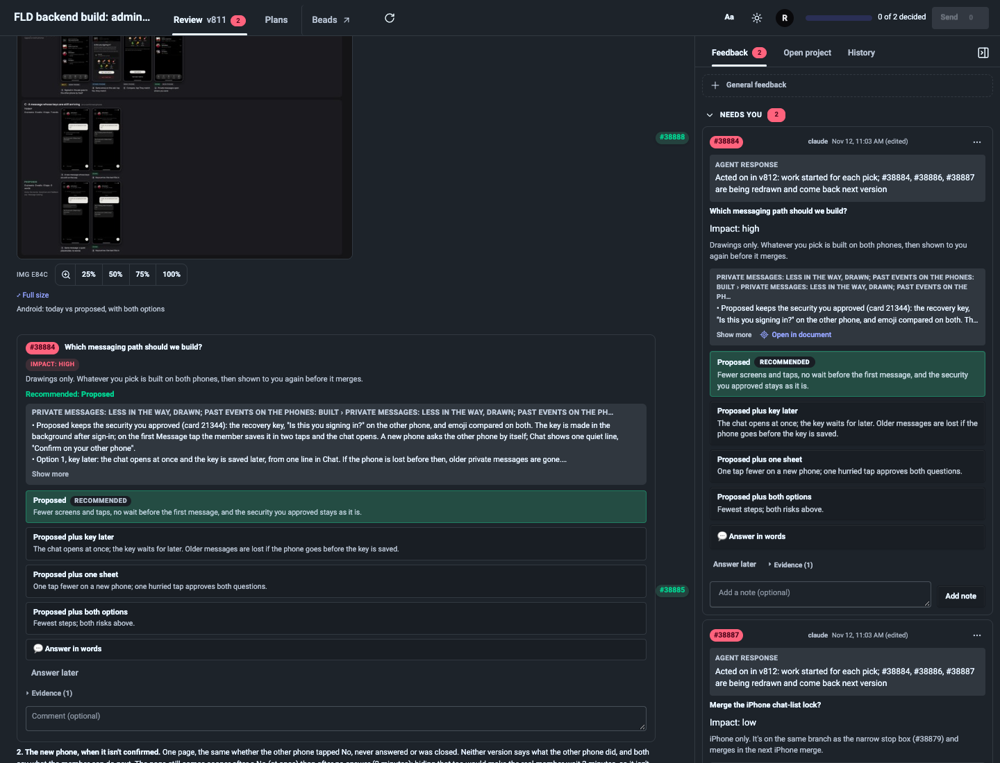
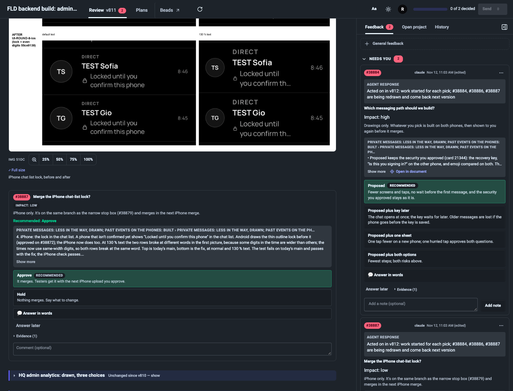
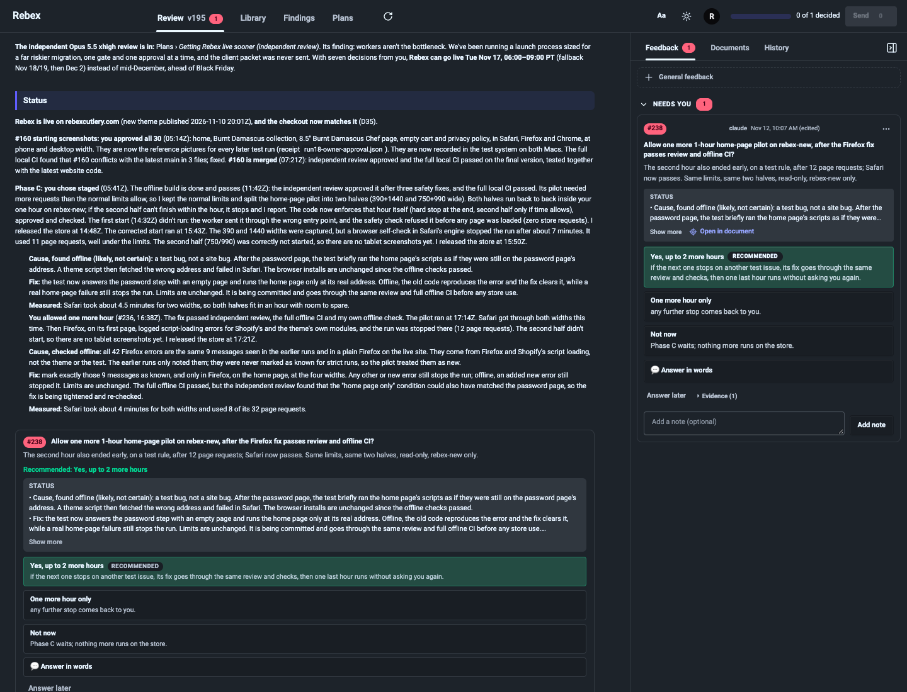

# Nearest-block card excerpts — 2026-11-13

Implicit ask cards now quote the nearest preceding paragraph, list, blockquote or table, plus images between that block and the card. They stop at a heading or previous ask. This removes the Status opening from Rebex v195 card 238 and narrows FLD v811 card 38884 to its Proposed/options list. Both FLD screenshot placements stay intact.

The coordinator explicitly selected the uniform last-block rule, accepting the narrower 38884 excerpt rather than an image-dependent exception.

## Why stored source is needed

An implicit section default and an explicit `see: s:status` normalize to identical card dictionaries and HTML. The content renderer therefore uses the existing Markdown parser on `source/vN.md` to identify numbered asks without explicit evidence. It sends only those anchor IDs in the existing content bootstrap; no new endpoint or agent-supplied field is needed. The adapter narrows just those excerpts. Explicit citations, including explicit same-section citations, keep their 2.31.3 behavior.

Nested prose inside an indented wrapper is selected without earlier sibling paragraphs. Wrapped tables exclude the adapter's scroll hint. Consecutive implicit asks stop at the previous ask; a card without preceding prose has no automatic excerpt. Card context sentences and placement are unchanged.

Missing, malformed, unreadable or escaping source paths retain the 2.31.3 behavior rather than guessing whether a citation was explicit. Source access uses the existing containment check and does not expose source text to the browser. Existing pages with stored source need no regeneration, republish or data migration.

Added agent writing: **0 characters per card**. Added model calls/AI tokens: **0**. Added orchestrator steps: **0**. Source parsing is deterministic work during the existing content request.

## Real cases in headless Google Chrome

Historical HTML, stored sources, comments and original image files were copied into a new sandbox. Only the copied target cards were reopened to reconstruct the view before answering. The servers used this worktree's absolute `PYTHONPATH` on explicit ports **18761** (FLD) and **18762** (Rebex). All relevant images decoded successfully; all servers and Chrome were closed afterward. No live page, installed runtime, skill or bead changed.

| Case | 2.31.3 quote length | New quote length | New beginning | Placement |
|---|---:|---:|---|---|
| FLD v811 #38884 | 1,854 | 824 | `• Proposed keeps the security you approved (card 21344): the recovery key, "Is t` | After its Android messaging drawing, before the unconfirmed-phone topic |
| FLD v811 #38887 | 615 | 615 | `4. iPhone: the lock in the chat list. A phone that isn't confirmed yet shows "Lo` | After its own lock before/after image |
| Rebex v195 #238 | 3,908 | 2,072 | `• Cause, found offline (likely, not certain): a test bug, not a site bug. After ` | After its cause/fix list, before the unrelated product-photo update; no screenshot was authored for this card |

[Machine-readable quotes, placement and runtime asset hashes](last-block-20261113/proof.json).

### FLD 38884

### FLD 38887

### Rebex 238

## Verification

- The real Rebex regression fails against installed 2.31.3: its quote contains `Rebex is live`, the starting-screenshot summary and the Phase C introduction.
- The real-case tests cover all four FLD asks, both requested FLD screenshot placements, and Rebex 238. Browser checks also cover body/rail/evidence-preview parity, reload, headings, prior asks, paragraphs, lists, blockquotes, wrapped tables, indented paragraphs and explicit citations.
- Unit tests cover identifying implicit versus explicit citations, including a `see:` string used as context; content-serving tests cover valid, missing, malformed and symlink-escaping source paths.
- Touched checks: `tests/test_ask_cards.py` passed all 27 tests in the initial focused run; `tests/test_server_security.py` passed all 36 tests; the final `tests/browser/test_card_context.py` run passed all 4 tests.
- Fast gate (`scripts/ci.py`, absolute worktree `PYTHONPATH`): **1,528 passed, 2 skipped**; Ruff and all JavaScript syntax checks passed.
- Broader browser card suites (`test_card_context.py`, `test_card_layout.py`, `test_card_state_consistency.py`, `test_card_jump.py`, `test_plain_text.py`, `test_section_fold.py`, `test_doc_fold.py`): **30 passed, 7 skipped** (WebKit unavailable).
- Full Windmill and WebKit execution are outside this validation; no release or merge performed.
